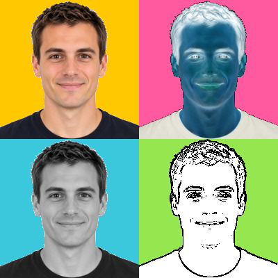
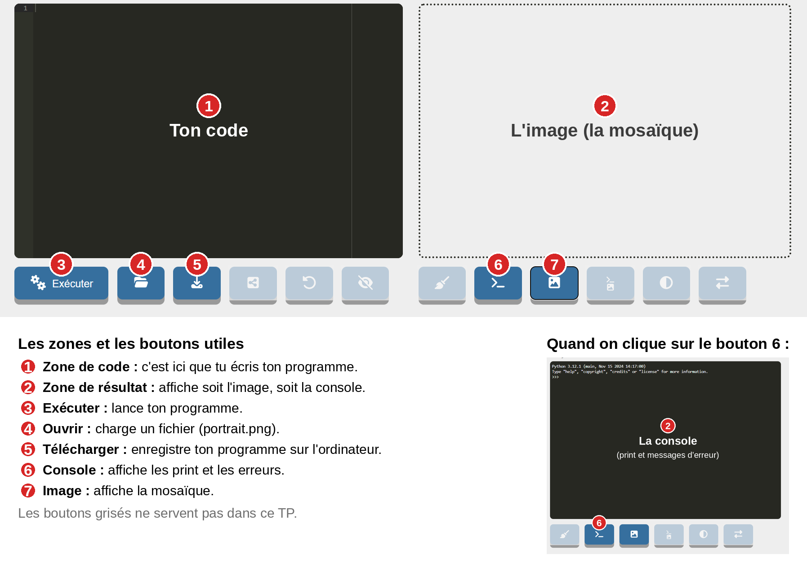

## Le but du TP {#but .sans-numero}

Tu vas écrire un programme qui fabrique une mosaïque de 4 **vignettes** de 200 × 200 pixels. Avec des fonds de couleur, on obtient un effet façon **Andy Warhol**, l'artiste du pop art célèbre pour ses portraits répétés en couleurs vives.

{.vignette}

Chaque partie se déroule en 3 temps :

- **Avant de coder** : tu réfléchis sur papier à ce que l'ordinateur devra faire ;
- **Le code** : tu écris le programme ;
- **Questions de compréhension** : tu vérifies que tu as compris ce que fait ton code.

::: checkpoint
**Les checkpoints.** À la fin de chaque partie, tu appelles le professeur. Il regarde ton travail et te pose une question. Tu passes à la suite seulement quand il a validé.
:::

### Ta feuille de réponses

Tu réponds aux questions numérotées (**Question 1**, **Question 2**, etc.) sur une feuille à part, avec ton nom, ton prénom et ta classe. Écris le numéro de la question devant chaque réponse. Les numéros des parties sont ceux du plan.

## Mise en route {#mise-en-route .sans-numero}

1. Ouvre **[Basthon](https://console.basthon.fr/?kernel=python)**.
2. Télécharge le portrait : [portrait.png](ressources/portrait.png){.bouton download="portrait.png"}

Basthon a deux zones. D'un côté, tu écris ton code. De l'autre, tu vois le résultat : soit l'image (la mosaique que tu vas créer), soit la console (affiche tes message "print()" et les erreurs) . Tu passes de l'une à l'autre avec les boutons 6 et 7.

{.vignette}

3. Dans Basthon, clique sur le bouton <kbd>Ouvrir</kbd> (icône dossier) et choisis le fichier `portrait.png`. Un message confirme que le fichier est chargé.
4. Dans la zone de code, recopie ces lignes :

   ```python
   from PIL import Image

   # Mise en route : on ouvre le portrait et on crée la mosaïque vide
   portrait = Image.open("portrait.png")
   mosaique = Image.new("RGB", (400, 400), (255, 255, 255))

   mosaique.show()
   ```

5. Clique sur <kbd>Exécuter</kbd>. Un carré blanc doit s'afficher (clique sur le bouton "Afficher la vue graphique" avec une icone d'image) : c'est ta mosaïque, encore vide.

### Ce que fait ce code

- `portrait` contient l'image du portrait ;
- `mosaique` est une nouvelle image de 400 × 400 pixels, toute blanche ;
- `mosaique.show()` affiche la mosaïque.

### Deux règles pour tout le TP

- `mosaique.show()` doit toujours rester la **dernière ligne** du programme. Tu écris tes nouvelles parties au-dessus.
- Chaque partie commence par un commentaire qui dit ce qu'elle fait, par exemple `# Partie 1 : copie de l'original`. Une ligne qui commence par `#` est ignorée par l'ordinateur : elle sert seulement à s'y retrouver dans le code.

::: alerte
Enregistre ton programme régulièrement avec le bouton <kbd>Télécharger</kbd> pour éviter de tout perdre en cas de soucis avec ton ordinateur ou ton navigateur.
:::

## Copier l'original {#partie-1}

**Objectif :** recopier le portrait, pixel par pixel, en haut à gauche de la mosaïque.

### Avant de coder

Dans une image, chaque pixel a des coordonnées `(x, y)` :

- le pixel `(0, 0)` est en haut à gauche ;
- `x` augmente quand on va vers la droite ;
- `y` augmente quand on va vers le bas (attention, c'est l'inverse des maths !).

**Question 1.** La mosaïque contient 2 vignettes de 200 pixels en largeur et 2 en hauteur. Quelle est sa taille complète ?

**Question 2.** Donne les coordonnées du coin en haut à gauche de chaque vignette.

| Vignette        | Coin en haut à gauche (x, y) |
| --------------- | ---------------------------- |
| Original        |                              |
| Négatif         |                              |
| Niveaux de gris |                              |
| Contours        |                              |

**Question 3.** Le pixel `(50, 30)` du portrait doit être recopié dans chaque vignette. Où arrive-t-il dans la vignette originale ? Dans la vignette négatif ? Dans la vignette contours ?

### Le code
 
**Comment :** avant de recopier le portrait, on apprend à colorier des pixels, étape par étape. À chaque étape, tu essaies, tu regardes ce qui se passe, puis on t'explique.
 
::: alerte
À chaque nouvelle étape, **remplace** le code de l'étape précédente. Garde toujours les lignes de la mise en route en haut, et `mosaique.show()` tout en bas.
:::
 
#### Étape 1 : colorier un pixel
 
Recopie cette ligne au-dessus de `mosaique.show()` :
 
```python
mosaique.putpixel((100, 50), (255, 0, 0))
```
 
Clique sur **Exécuter**, puis sur **Image**. Regarde bien : il y a un tout petit point rouge. C'est **un pixel**.
 
**Ce qui se passe :** `putpixel` colorie un pixel de la mosaïque. On lui dit **où**, avec `(100, 50)`, et **quelle couleur**, avec `(255, 0, 0)`, ici du rouge.
 
**Essaie :**
 
- remplace `(100, 50)` par `(300, 50)` : le point se déplace vers la droite ;
- remplace `(255, 0, 0)` par `(0, 0, 255)` : le point devient bleu.
#### Étape 2 : tracer une ligne
 
Remplace ton code par celui-ci et exécute :
 
```python
for x in range(200):
    mosaique.putpixel((x, 50), (255, 0, 0))
```
 
Une ligne rouge apparaît.
 
**Ce qui se passe :** la ligne `for` **répète** l'instruction en dessous, 200 fois. À chaque fois, `x` augmente de 1 : 0, puis 1, puis 2... jusqu'à 199. Le pixel colorié avance donc d'un cran à chaque fois, et ça trace une ligne.
 
::: alerte
Le décalage vers la droite (l'**indentation**) est obligatoire : il montre ce qui est répété.
:::
 
**Essaie :**
 
- remplace `range(200)` par `range(100)` : la ligne est deux fois plus courte ;
- remplace le `50` par `150` : la ligne descend.
**Et si on oublie `x` ?** Remplace `(x, 50)` par `(0, 0)` et exécute. On ne voit plus qu'un seul point dans le coin : l'ordinateur a colorié 200 fois **le même** pixel. Remets `(x, 50)`.
 
::: alerte
Dans une boucle, il faut écrire `x` (et `y`) dans les coordonnées, pas des nombres.
:::
 
#### Étape 3 : voir les coordonnées défiler
 
Remplace ton code par celui-ci, exécute, puis clique sur **Console** :
 
```python
for x in range(3):
    for y in range(3):
        print(x, y)
```
 
**Ce qui se passe :** avec **deux boucles, l'une dans l'autre**, l'ordinateur passe par **toutes les coordonnées** : `0 0`, `0 1`, `0 2`, puis `1 0`, `1 1`, `1 2`... Colonne par colonne.
 
**Essaie :** remplace les deux `3` par des `10`. La liste est beaucoup plus longue : l'ordinateur passe par les 100 pixels d'un carré de 10 × 10.
 
#### Étape 4 : remplir un carré
 
Remplace ton code par celui-ci, exécute, puis clique sur **Image** :
 
```python
for x in range(200):
    for y in range(200):
        mosaique.putpixel((x, y), (255, 0, 0))
```
 
Tout le carré en haut à gauche devient rouge.
 
**Ce qui se passe :** les deux boucles passent par tous les pixels de `(0, 0)` à `(199, 199)`, et chacun est colorié en rouge. Ce carré, c'est exactement la place de l'original dans la mosaïque.
 
**Essaie :** remplace `(255, 0, 0)` par `(0, 255, 0)` : le carré devient vert.
 
#### Étape 5 : lire la couleur d'un pixel du portrait
 
Il reste à remplacer le rouge par **la vraie couleur de chaque pixel du portrait**. Pour lire la couleur d'un pixel, on utilise `getpixel` :
 
```python
r, v, b = portrait.getpixel((x, y))
```
 
**Ce qui se passe :** la couleur du pixel `(x, y)` du portrait est faite de trois nombres, ses **composantes** : le rouge, le vert et le bleu. On les range dans trois boîtes appelées `r`, `v` et `b`, pour s'en servir juste après.
 
#### À toi
 
Remplace ton code par celui-ci, complète les `...` et exécute.
 
```python
# Partie 1 : copie de l'original (en haut à gauche)
for x in range(200):
    for y in range(200):
        r, v, b = portrait.getpixel((..., ...))    # on lit la couleur du pixel (x, y) du portrait
        mosaique.putpixel((..., ...), (r, v, b))   # on l'écrit au même endroit dans la mosaïque
```
 
Tu dois voir le portrait en haut à gauche de la mosaïque.
### Questions de compréhension

**Question 4.** Ajoute la ligne `print(portrait.getpixel((0, 0)))` et exécute. Quelle est la couleur du pixel en haut à gauche ? Est-ce logique ?

**Question 5.** Combien de fois les instructions à l'intérieur des deux boucles sont-elles exécutées ?

**Question 6.** Que se passerait-il avec `range(100)` pour `x` et pour `y` ?

::: checkpoint 1
Appelle le professeur pour faire valider ton travail.
:::

## Fabriquer le négatif {#partie-2}

**Objectif :** fabriquer le négatif du portrait, en haut à droite de la mosaïque.

### Avant de coder

**Question 7.** Donne la formule du négatif pour une composante `p`. Pour rappel, une composante est l'un des trois nombres qui forment la couleur d'un pixel : le rouge, le vert ou le bleu.

**Question 8.** Calcule le négatif du pixel `(200, 150, 30)`.

**Question 9.** D'après la question 3, de combien faut-il décaler `x` pour écrire dans la vignette en haut à droite ? Et `y` ?

### Le code

**Comment :** c'est presque la même chose que la partie 1. Pour chaque pixel :

- on lit sa couleur `(r, v, b)`, comme dans la partie 1 ;
- on calcule le négatif de chaque composante ;
- on écrit le résultat dans la mosaïque, 200 pixels plus à droite.

#### En Python : calculer avec des variables

```python
a = 10
c = a + 5
```

L'ordinateur calcule 10 + 5 et range le résultat dans la variable `c`, qui vaut donc 15. On peut calculer de la même façon avec `r`, `v` et `b`.

#### À toi

Sous ta partie 1 (et toujours au-dessus de `mosaique.show()`), écris la partie 2 en t'aidant de ce squelette :

```python
# Partie 2 : le négatif (en haut à droite)
for ... :                # comme dans la partie 1
    for ... :            # comme dans la partie 1
        r, v, b = ...    # comme dans la partie 1 : on lit le pixel (x, y)
        negatif_r = ...  # négatif du rouge
        negatif_v = ...  # négatif du vert
        negatif_b = ...  # négatif du bleu
        mosaique.putpixel(...)  # on écrit le négatif, décalé de 200 vers la droite
```

### Questions de compréhension

**Question 10.** Le fond du portrait est blanc. De quelle couleur est-il dans le négatif ? Explique avec un calcul.

**Question 11.** Que se passerait-il si on calculait le négatif du négatif ?

::: checkpoint 2
Appelle le professeur pour faire valider ton travail.
:::

## Passer en niveaux de gris {#partie-3}

**Objectif :** fabriquer la version en niveaux de gris du portrait, en bas à gauche.

### Avant de coder

Un pixel est gris quand ses trois composantes R, V et B sont égales. Pour transformer un pixel de couleur en gris, on calcule la **moyenne** de ses trois composantes, puis on met cette moyenne dans les trois.

**Question 12.** Calcule le gris du pixel `(200, 150, 40)`.

**Question 13.** Pourquoi un pixel avec R = V = B est-il gris ?

**Question 14.** Pour écrire dans la vignette en bas à gauche, quel décalage faut-il appliquer ?

### Le code

**Comment :** pour chaque pixel :

- on lit sa couleur `(r, v, b)`, comme d'habitude ;
- on calcule la moyenne des 3 composantes ;
- on écrit cette moyenne dans les 3 composantes, 200 pixels plus bas.

#### En Python : la division entière `//`

Une composante de couleur doit être un nombre **entier** (pas de virgule). Or une moyenne tombe rarement juste :

- `391 / 3` donne `130.33...` : refusé par `putpixel` ;
- `391 // 3` donne `130` : c'est la **division entière**, elle garde seulement la partie entière.

#### À toi

Écris la partie 3. Cette fois, tu sais écrire les boucles et lire le pixel tout seul. Voici seulement les lignes nouvelles :

```python
# Partie 3 : les niveaux de gris (en bas à gauche)
...  # boucles et lecture du pixel, comme avant
    gris = (... + ... + ...) // 3
    mosaique.putpixel((..., ...), (gris, gris, gris))
```

### Questions de compréhension

**Question 15.** Calcule le gris du rouge pur `(255, 0, 0)`, puis celui du bleu pur `(0, 0, 255)`. Que remarques-tu ?

**Question 16.** Remplace `//` par `/` et exécute. Que se passe-t-il ? Remets `//` ensuite.

::: checkpoint 3
Appelle le professeur pour faire valider ton travail.
:::

## Tracer les contours {#partie-4}

**Objectif :** transformer le portrait en dessin au crayon, en bas à droite.

### Avant de coder

Un **contour**, c'est un endroit de l'image où la luminosité change brusquement, par exemple le bord des cheveux foncés sur le fond blanc. Pour le trouver, on compare chaque pixel à son voisin.

Voici les gris de 6 pixels voisins sur une ligne de l'image :

| Pixel                            | 1   | 2   | 3   | 4   | 5   | 6   |
| -------------------------------- | --- | --- | --- | --- | --- | --- |
| Gris                             | 200 | 198 | 205 | 60  | 58  | 62  |
| Écart avec le voisin de droite   |     |     |     |     |     |     |
| Couleur du pixel (noir ou blanc) |     |     |     |     |     |     |

**Question 17.** Calcule l'écart entre chaque pixel et son voisin de droite (toujours positif).

**Question 18.** Entre quels pixels se trouve le contour ?

**Question 19.** On fixe la règle suivante : si l'écart est plus grand que 30, le pixel devient noir (c'est le « trait de crayon »), sinon il devient blanc. Complète la dernière ligne du tableau pour les 5 premiers pixels.

**Question 20.** Dans une vignette, `x` va de 0 à 199. Le pixel `x = 199` a-t-il un voisin à droite ? Qu'en conclure ?

### Le code

**Comment :** pour chaque pixel :

- on calcule l'écart de gris avec son voisin de droite ;
- on calcule l'écart de gris avec son voisin du dessous ;
- si l'un des deux écarts est plus grand que le seuil, le pixel devient noir ; sinon, il devient blanc ;
- on écrit ce pixel dans la vignette en bas à droite.

#### Une fonction pour t'aider (fournie)

On va avoir besoin du gris de beaucoup de pixels. Plutôt que de réécrire le calcul à chaque fois, on le range dans une **fonction** : on lui donne `x` et `y`, elle renvoie le gris du pixel.

```python
def gris_de(x, y):
    r, v, b = portrait.getpixel((x, y))
    return (r + v + b) // 3
```

Par exemple, `gris_de(10, 20)` donne le gris du pixel `(10, 20)`.

#### En Python : l'écart avec `abs`

`abs` donne la valeur absolue, c'est-à-dire l'écart sans le signe moins : `abs(60 - 205)` vaut 145, comme `abs(205 - 60)`.

#### En Python : la condition `if ... else`

Une condition permet à l'ordinateur de faire un choix :

```python
if ecart > 20:
    couleur = (0, 0, 0)        # si c'est vrai : noir
else:
    couleur = (255, 255, 255)  # sinon : blanc
```

#### En Python : `or`

`ecart1 > 20 or ecart2 > 20` est vrai si **au moins un** des deux écarts dépasse 20.

#### À toi

Recopie la fonction `gris_de` sous ta partie 3, puis complète la suite :

```python
# Partie 4 : les contours (en bas à droite)
seuil = 20

for x in range(199):
    for y in range(199):
        ecart1 = abs(gris_de(x, y) - gris_de(x + 1, y))  # voisin de droite
        ecart2 = abs(gris_de(x, y) - gris_de(x, y + 1))  # voisin du dessous
        if ... > seuil or ... > seuil:
            couleur = ...  # contour : noir
        else:
            couleur = ...  # pas de contour : blanc
        mosaique.putpixel((..., ...), couleur)
```

### Questions de compréhension

**Question 21.** Pourquoi les boucles utilisent-elles `range(199)` et pas `range(200)` ?

**Question 22.** Change la valeur du `seuil` : essaie 10, puis 80. Que remarques-tu ?

**Question 23.** Enlève `or ecart2 > seuil` et exécute. Quels contours disparaissent ? Remets-le ensuite.

::: checkpoint 4
Appelle le professeur pour faire valider ton travail.
:::

## Pour aller plus loin {#plus-loin .sans-numero}

### Fausses couleurs

Dans ta partie 1, remplace `(r, v, b)` par `(b, v, r)` dans `putpixel`. Essaie aussi `(v, r, b)` et `(r, b, v)`.

**Question 24.**

a) Que se passe-t-il ?

b) Explique pourquoi.

### Un fond de couleur

Les pixels du fond sont presque blancs : leurs trois composantes sont toutes grandes. On peut donc les repérer avec une condition, et les remplacer par une couleur. Dans ta partie 1, remplace la ligne `putpixel` par :

```python
if r > 230 and v > 230 and b > 230:
    mosaique.putpixel((x, y), (255, 200, 0))  # pixel du fond : jaune
else:
    mosaique.putpixel((x, y), (r, v, b))      # sinon : on garde la couleur
```

`and` veut dire « et » : la condition est vraie seulement si les trois composantes dépassent 230.

**Question 25.**

a) Remplace 230 par 245. Pourquoi reste-t-il un contour blanc autour des cheveux ?

b) **Défi :** mets un fond de couleur différent dans chaque vignette. Attention, le fond du négatif est noir !

c) Est-ce que cette méthode marcherait avec une photo prise devant un paysage ? Pourquoi ?
